<p align="center">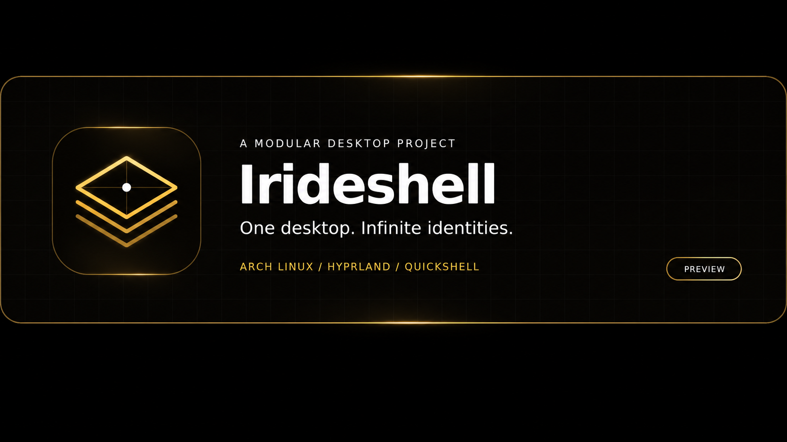</p>

<p align="center"><a href="README.pt-BR.md">Português (Brasil)</a> · <a href="CREDITS.md">Credits</a> · <a href="LICENSE">GPL-3.0</a> · <a href="docs/DEVELOPMENT.md">Development guide</a></p>

> **Source-only development preview — target: v0.9.0-beta.** Available on the development branch; no tagged beta yet. Assembly and dry-run were tested on the source Arch machine; clean-system installation and graphical runtime of the assembled package remain untested. The assembled distribution and official beta remain pending the [release audit](RELEASE-AUDIT.md).

## Make the desktop yours

Irideshell is a modular Hyprland desktop configuration derived from illogical-impulse and end4-pC. Its focus is a coherent theme experience: change a wallpaper and recover the associated palette, widget layout and collage profile. Choose the components you need instead of replacing your entire desktop.

### Highlights

- **Wallpaper-linked themes:** named palettes, primary/secondary/tertiary color editing and image associations.
- **Persistent layouts:** per-wallpaper widget positions, sizes and images; per-scheme collage profiles.
- **Wallpaper manager:** static and animated libraries, import and preview controls.
- **Theme Studio:** color editing, contrast, opacity, theme avatar and card images.
- **Terminal integration:** optional Kitty, Fish and Fastfetch configuration and theme synchronization.
- **Modular setup:** dry-run by default, file-level backups, selective updates and uninstall.

These features originate in both upstream projects and the derivative's modifications; see [modification history](MODIFICATIONS.md). The original desktop demonstrates them; the assembled installer has not yet been visually validated.

## Showcase

### Video demonstrations

- [Showcase — settings and wallpapers](assets/videos/showcase.mp4)
- [Dynamic theme switching](assets/videos/theme-switching.mp4)

Full, silent demonstrations of the original desktop (60 s and 65 s). Links open the MP4 files on GitHub. Optional integrations such as HyprEndfield are not included in the installer.

### Desktop screenshots

**Bibian**

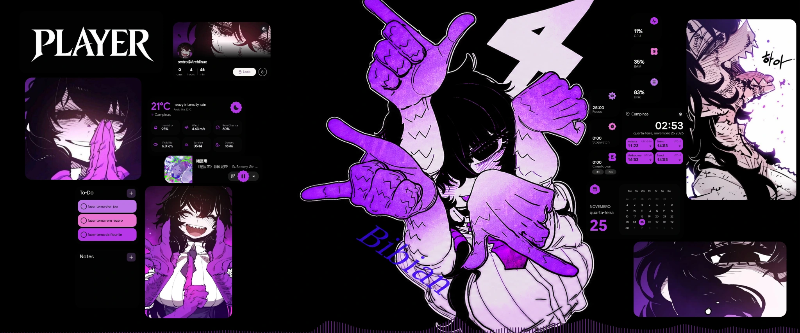

**Haimiya**

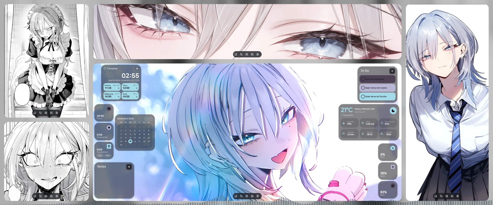

**Multi-wallpaper collage**

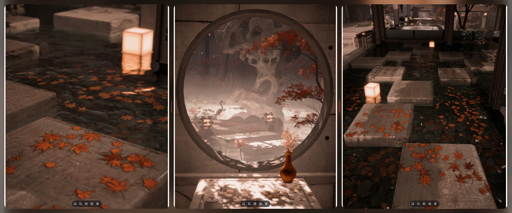

**Shorekeeper**

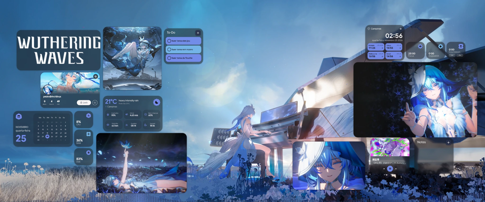

**Pastis**

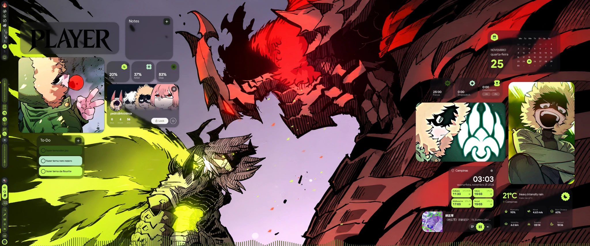

**Wallpaper picker**

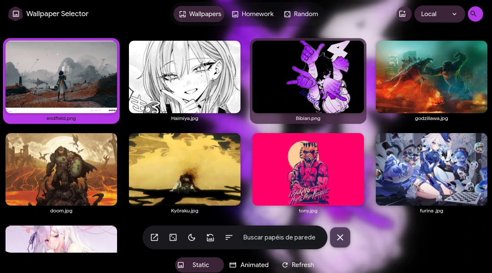

**Animated wallpapers**

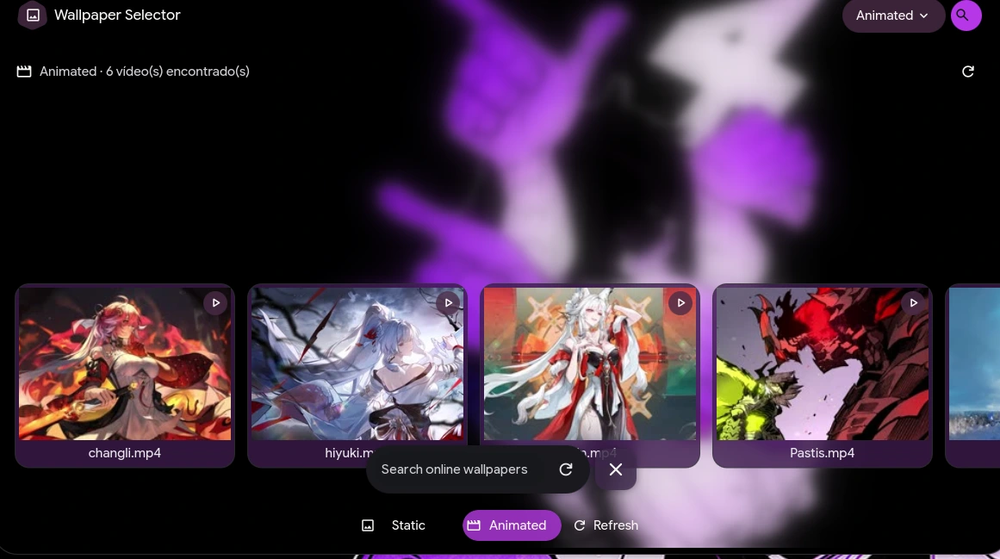

**Color editor**

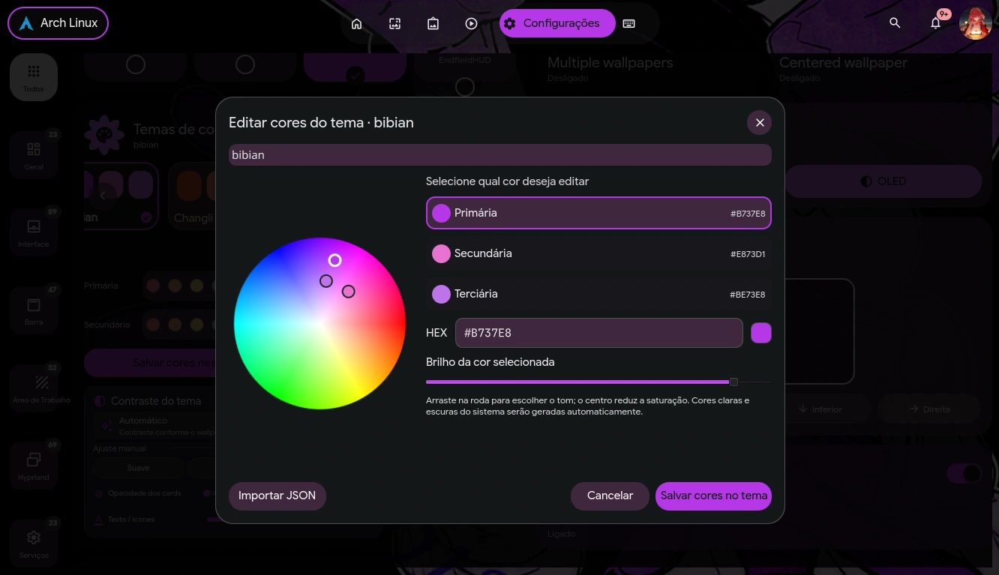

**Application dashboard**

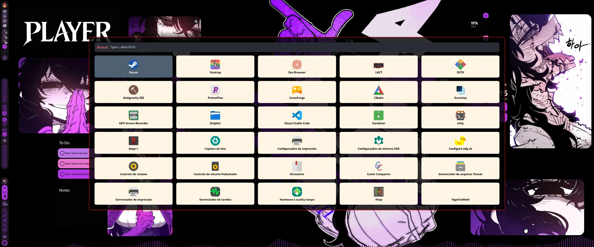

### Palettes

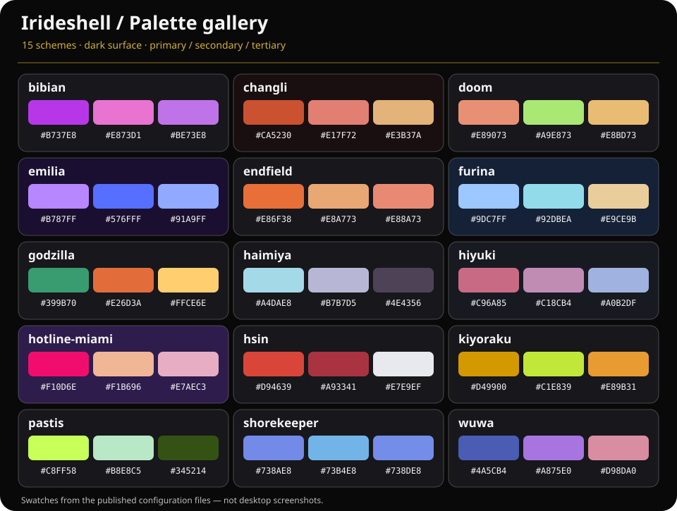

The swatches are derived from the actual published theme JSON files. This is a palette reference, not a screenshot of a running desktop. See the [full palette table](docs/PALETTES.md).

Screenshots and full videos are maintainer-provided demonstrations, not wallpapers distributed by the installer. Third-party artwork and trademarks remain subject to their respective owners’ rights and are not licensed by the code’s GPL. Clean-system installation is not validated. See [media plan](docs/MEDIA-PLAN.md).

## Modules

| Module | Scope | Requirements |
| --- | --- | --- |
| `launcher` | Rofi compact launcher and dashboard | Rofi |
| `terminal` | Kitty, Fish, Fastfetch and helpers | Kitty, Fish, Fastfetch |
| `themes` | 15 named color schemes | Compatible shell |
| `shell` | Quickshell, widgets, wallpapers, collage | Prepared base and compatible dependencies |
| `desktop-base` | Hyprland and Matugen configuration | Prepared base; also selects shell |
| `desktop` | All of the above | All applicable requirements |

Widgets and wallpaper tools are part of `shell`, not separately installable modules yet. HyprEndfield is optional: [local build and installation from an authorized source archive](docs/HYPRENDFIELD.md). The application, game-derived assets and SDDM are not bundled.

## Try the installer in a disposable environment

Run as a normal user. Do not install over a working desktop for testing. The following commands only list or simulate the operation:

```bash
./setup list
./setup install --modules launcher
./setup install --modules terminal
./setup doctor
```

For the shell or full desktop, `./setup prepare --apply` downloads pinned upstream repositories into `prepared/`, without changing desktop settings. `./setup install` then previews the full overlay. Required system dependencies are not installed by the overlay; the separate experimental `bootstrap` delegates to the upstream installer and is not covered by our file backups. See the [development guide](docs/DEVELOPMENT.md) before any real installation.

## Manage your installation

| Command | Purpose |
| --- | --- |
| `./setup update` | Preview an update from the local project version |
| `./setup backup` | Back up managed configuration files |
| `./setup restore` | Reverse the latest completed transaction |
| `./setup uninstall --modules launcher` | Preview selective removal |
| `./setup doctor` | Static dependency and managed-file checks |
| `./setup audit` | Release preflight (heuristic, not certification) |

Mutating operations require `--apply`; replacements require `--replace` where supported. File backups do not include personal wallpaper/layout state or system package changes. The installer does not automatically fetch updates or remove system packages.

## Privacy and external services

The fallback screenshot-search shortcut (`Super+Shift+A`, when Quickshell is not running) asks for confirmation before uploading the selected screenshot to uguu.se and opening Google Lens with its URL. Remote retention is controlled by those services. Cancel if the screen contains private information. The pinned upstream shell has its own online features; their network behavior has not been fully reviewed. See [release audit](RELEASE-AUDIT.md).

## License and attribution

Irideshell is a derivative of [end-4/dots-hyprland](https://github.com/end-4/dots-hyprland) and [pctrade/end4-pC](https://github.com/pctrade/end4-pC), maintained by [pedrogonzalez-png](https://github.com/pedrogonzalez-png). The GPL-covered code remains under GPL v3. Third-party notices and licenses remain applicable. See [credits](CREDITS.md), [upstream revisions](upstream-lock.json) and [release audit](RELEASE-AUDIT.md). No affiliation with the game or character rights holders is claimed.
