<p align="center">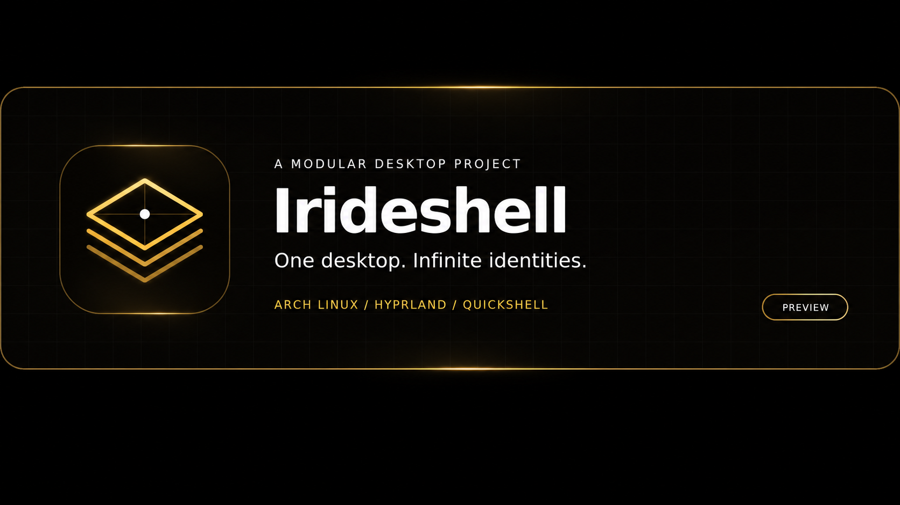</p>

<p align="center"><a href="README.md">English</a> · <a href="CREDITS.md">Créditos</a> · <a href="LICENSE">GPL-3.0</a> · <a href="docs/DEVELOPMENT.md">Guia técnico</a></p>

> **Prévia de desenvolvimento (somente código-fonte) — meta: v0.9.0-beta.** Prévia pública de desenvolvimento; ainda sem release beta. A montagem e a simulação foram testadas no Arch de origem; a instalação limpa e o funcionamento visual do pacote montado ainda não foram validados. A distribuição do pacote montado e a beta oficial dependem da [auditoria](RELEASE-AUDIT.md).

## Um desktop. Infinitas identidades.

Irideshell é uma configuração modular de desktop Hyprland derivada do illogical-impulse e do end4-pC. Sua proposta é integrar os temas: ao escolher um wallpaper, recuperar a paleta, a organização dos widgets e o perfil de mosaico associados. Instale somente os componentes que deseja.

### Destaques

- **Temas por wallpaper:** paletas nomeadas, edição de cores primária, secundária e terciária, e associação de imagens.
- **Layouts persistentes:** posições, dimensões e imagens dos widgets por wallpaper; mosaicos por esquema.
- **Gerenciador de wallpapers:** bibliotecas estática e animada, importação e prévias.
- **Theme Studio:** edição de cores, contraste, opacidade, avatar e imagens dos cards.
- **Integração do terminal:** configurações opcionais do Kitty, Fish e Fastfetch, com sincronização de temas.
- **Instalação modular:** simulação por padrão, backups de arquivos, atualização e remoção seletivas.

As funcionalidades combinam contribuições dos projetos originais e modificações desta versão; consulte o [histórico de alterações](MODIFICATIONS.md). Elas são demonstradas pelo desktop de origem; o instalador montado ainda não passou por validação visual.

## Galeria e demonstrações

### Vídeos de demonstração

Assista às duas demonstrações do desktop abaixo.

https://github.com/user-attachments/assets/ddf77c0c-b26d-4b93-bf22-047db4aca6f7

https://github.com/user-attachments/assets/5a3277e7-48ab-42ac-bda9-a0e4e2501030

Originais em resolução completa: [Irideshell Showcase (1:00)](assets/videos/showcase.mp4) · [Troca dinâmica de temas (1:05)](assets/videos/theme-switching.mp4).

As gravações demonstram o desktop de origem. Integrações opcionais, como HyprEndfield, exigem instalação separada.

### Capturas do desktop

**Bibian**

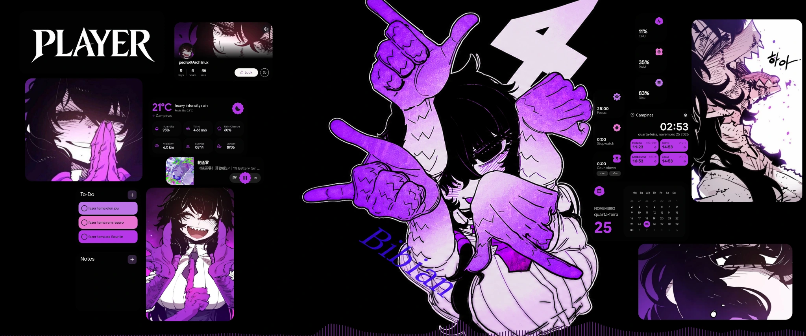

**Haimiya**

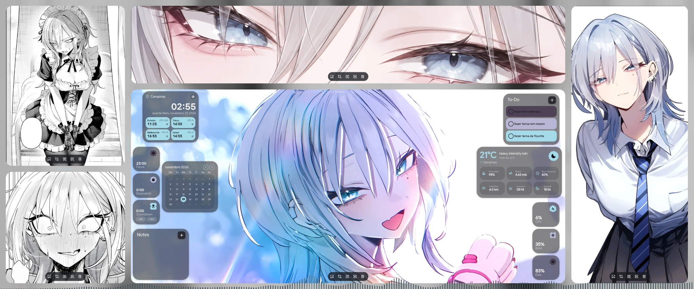

**Mosaico de wallpapers**

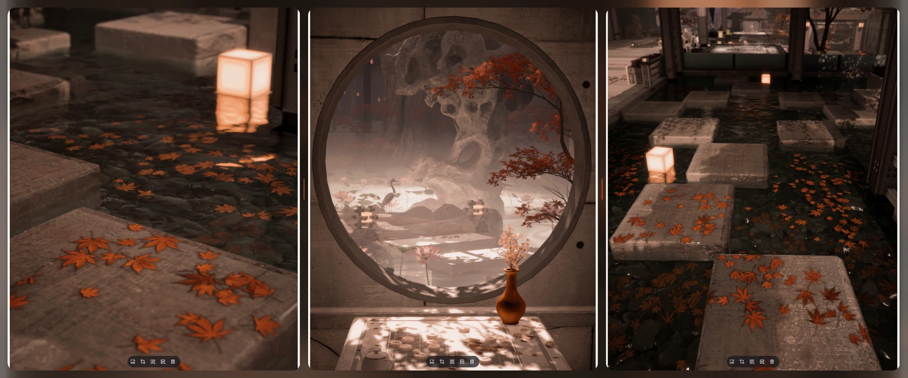

**Shorekeeper**

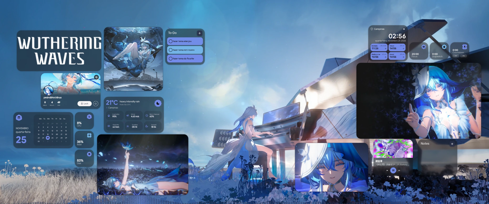

**Pastis**

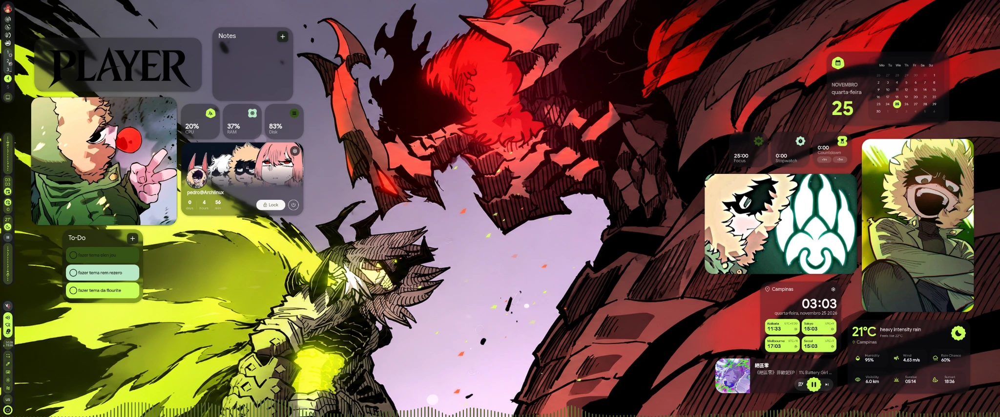

**Seletor de wallpapers**

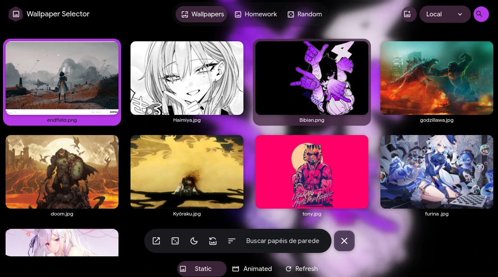

**Wallpapers animados**

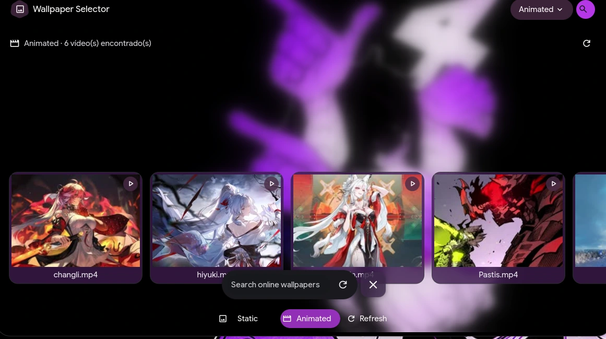

**Editor de cores**

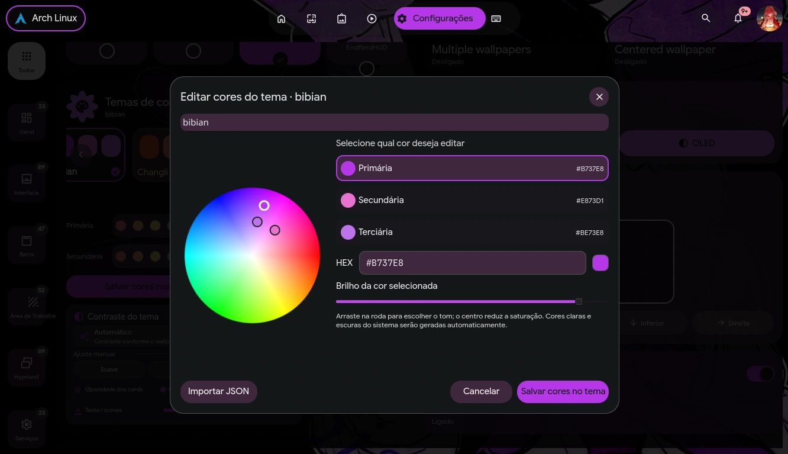

**Dashboard de aplicativos**

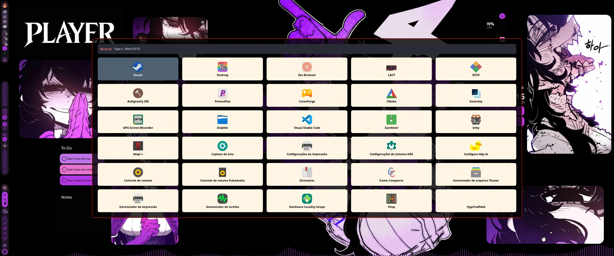

### Paletas

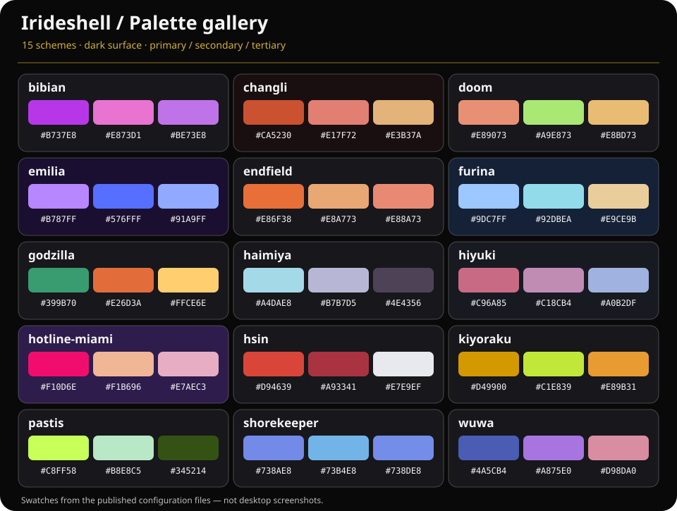

A galeria usa as cores reais dos JSONs de temas publicados. É uma referência de paletas, não uma captura do desktop. Consulte a [tabela completa](docs/PALETTES.md).

As capturas e os vídeos completos são demonstrações fornecidas pelo mantenedor, não wallpapers distribuídos pelo instalador. As artes e marcas de terceiros permanecem sob os direitos dos respectivos titulares; não são licenciadas pela GPL do código. A instalação limpa não foi validada. Veja o [plano de mídia](docs/MEDIA-PLAN.md).

## Módulos

| Módulo | Conteúdo | Requisitos |
| --- | --- | --- |
| `launcher` | Rofi compacto e dashboard | Rofi |
| `terminal` | Kitty, Fish, Fastfetch e auxiliares | Kitty, Fish, Fastfetch |
| `themes` | 15 esquemas de cores | Shell compatível |
| `shell` | Quickshell, widgets, wallpapers e mosaicos | Base preparada e dependências compatíveis |
| `desktop-base` | Hyprland e Matugen | Base preparada; seleciona também shell |
| `desktop` | Todos os módulos acima | Todos os requisitos aplicáveis |

Widgets e ferramentas de wallpaper fazem parte de `shell`, não são módulos independentes nesta versão. HyprEndfield é opcional: [compilação e instalação local a partir de um arquivo-fonte autorizado](docs/HYPRENDFIELD.md). O [código-fonte personalizado do HUD](vendor/hyprendfield/IRIDESHELL.md) está disponível para revisão; o aplicativo compilado, os recursos necessários derivados do jogo e o SDDM não estão incluídos.

## Instalação rápida — prévia de desenvolvimento

**Use uma VM Arch Linux descartável ou uma conta de teste, não seu desktop de uso diário.** A instalação gráfica em um Arch limpo ainda não foi validada. Tenha Git, Bash e Python 3 disponíveis; cada módulo exige seus próprios programas instalados.

### 1. Baixe o projeto

```bash
git clone --depth 1 https://github.com/pedrogonzalez-png/Irideshell.git
cd Irideshell
./setup list
./setup doctor
```

### 2. Escolha um módulo e simule

```bash
./setup install --modules launcher
./setup install --modules terminal
```

Esses comandos não alteram sua configuração. Rofi ou Kitty/Fish/Fastfetch, respectivamente, já devem estar instalados antes de aplicar o módulo correspondente. Os temas exigem um shell compatível.

### 3. Prepare o desktop completo (opcional)

```bash
./setup prepare --apply
./setup install
```

A preparação baixa as revisões fixadas dos projetos originais e monta `prepared/` dentro do repositório, sem modificar o desktop. O segundo comando apenas simula a instalação dos arquivos. O instalador não instala dependências do sistema. O bootstrap experimental separado pode alterar pacotes, serviços e configurações existentes: use-o somente em uma VM descartável, após criar um snapshot.

### 4. Aplique somente em ambiente de teste

Por exemplo, após instalar os pré-requisitos do launcher e revisar a simulação:

```bash
./setup install --modules launcher --apply
```

Arquivos existentes diferentes são recusados, exceto quando você autoriza expressamente a substituição com `--replace`. Não use essa opção sem revisar o plano. O instalador não recarrega o desktop automaticamente. Para instalação completa, recuperação, dependências e limites dos backups, leia primeiro o [guia técnico](docs/DEVELOPMENT.md). O dashboard nativo é o padrão; o [HyprEndfield](docs/HYPRENDFIELD.md) é opcional e exige recursos locais autorizados.

## Gerenciamento

| Comando | Função |
| --- | --- |
| `./setup update` | Simular atualização pela versão local |
| `./setup backup` | Backup dos arquivos gerenciados |
| `./setup restore` | Reverter a última transação concluída |
| `./setup uninstall --modules launcher` | Simular remoção seletiva |
| `./setup doctor` | Diagnóstico estático |
| `./setup audit` | Auditoria heurística, sem certificação |

Operações de escrita exigem `--apply`; substituições exigem `--replace` quando aceito. Os backups não abrangem os wallpapers/layouts pessoais nem mudanças em pacotes do sistema. Não há atualização automática pela rede ou remoção de pacotes.

## Privacidade e serviços externos

O atalho alternativo de pesquisa por captura (`Super+Shift+A`, quando o Quickshell não está em execução) pede confirmação antes de enviar a região selecionada ao uguu.se e abrir o Google Lens com a URL. A retenção remota depende desses serviços. Cancele se houver informações privadas na tela. O shell original possui recursos online próprios, cujo comportamento de rede ainda não foi integralmente revisado. Consulte a [auditoria](RELEASE-AUDIT.md).

## Licença e créditos

Projeto derivado de [end-4/dots-hyprland](https://github.com/end-4/dots-hyprland) e [pctrade/end4-pC](https://github.com/pctrade/end4-pC), mantido por [pedrogonzalez-png](https://github.com/pedrogonzalez-png). O código abrangido pela GPL continua sob GPL v3. Licenças e avisos de terceiros permanecem aplicáveis. Consulte [créditos](CREDITS.md), [revisões originais](upstream-lock.json) e [auditoria](RELEASE-AUDIT.md). Não há vínculo oficial com os titulares das artes e marcas.
